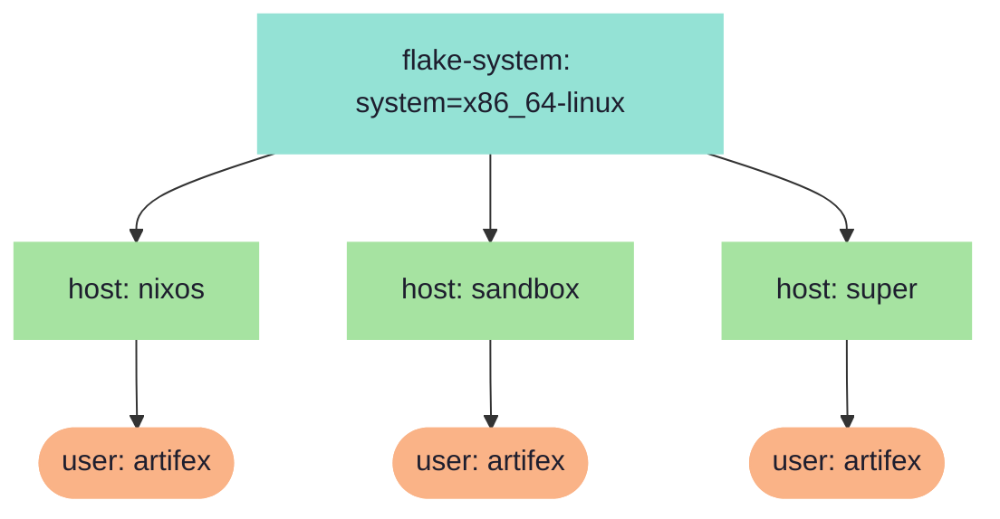
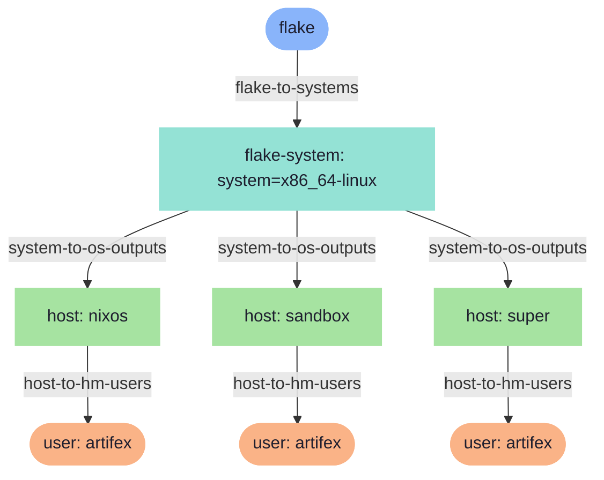
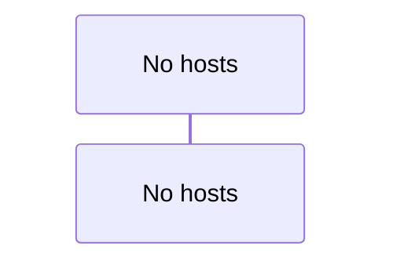

# Fleet Topology

Auto-generated visualizations of the nix-config fleet's
aspect-resolution pipeline, scope tree, and data flow.

## Scope Topology

## Policy Resolution

## Pipe Flow

## Pipe Sequence

## Fleet Summary

# Fleet Summary

## Topology

- **0** environments, **3** hosts, **1** users
- Scope chain: flake → flake-system → host → user
- Trace entries: 557

## Environments

| Environment | Hosts | Host Count | Users |
| ------------- | ------- | ------------ | ------- |

## Aspects by Host

| Host | Aspect Count | Aspects |
| ------ | -------------- | --------- |
| nixos | 7 | define-user/artifex@nixos, host/resolve(dev), hostname/os, impermanence, inputs'/os, nixos, self'/os |
| sandbox | 5 | define-user/artifex@sandbox, hostname/os, inputs'/os, sandbox, self'/os |
| super | 7 | define-user/artifex@super, host/resolve(dev), hostname/os, impermanence, inputs'/os, self'/os, super |

## Pipes

| Pipe | Scope Boundary | Producers | Collectors |
| ------ | ---------------- | ----------- | ------------ |
| cache | flake-system: system=x86_64-linux | nixos, super |  |
| cacheHome | flake-system: system=x86_64-linux | nixos, sandbox, super |  |
| codium-extensions | flake-system: system=x86_64-linux | nixos, super |  |
| codium-settings | flake-system: system=x86_64-linux | nixos, super |  |
| devenv | flake-system: system=x86_64-linux | nixos, super |  |
| homeManagerModules | flake-system: system=x86_64-linux | nixos, super |  |
| isWorkstation | flake-system: system=x86_64-linux | nixos, sandbox, super |  |
| nixpkgs-overlays | flake-system: system=x86_64-linux | nixos, sandbox, super |  |
| persist | flake-system: system=x86_64-linux | nixos, sandbox, super |  |
| persistHome | flake-system: system=x86_64-linux | nixos, sandbox, super |  |
| tests | flake-system: system=x86_64-linux | nixos, super |  |

## Policies

| Policy | Fires at |
| -------- | ---------- |
| flake-to-systems | flake |
| apps-to-flake | flake-system |
| checks-to-flake | flake-system |
| devShells-to-flake | flake-system |
| legacyPackages-to-flake | flake-system |
| packages-to-flake | flake-system |
| system-to-os-outputs | flake-system |
| host-to-hm-users | host |
| host-to-users | host |
| os-to-host | host |
| artifex/to-hosts | user |
| hm-user-detect | user |
| host-aspects-project | user |
| project-user-overlays | user |
| user-to-host | user |
